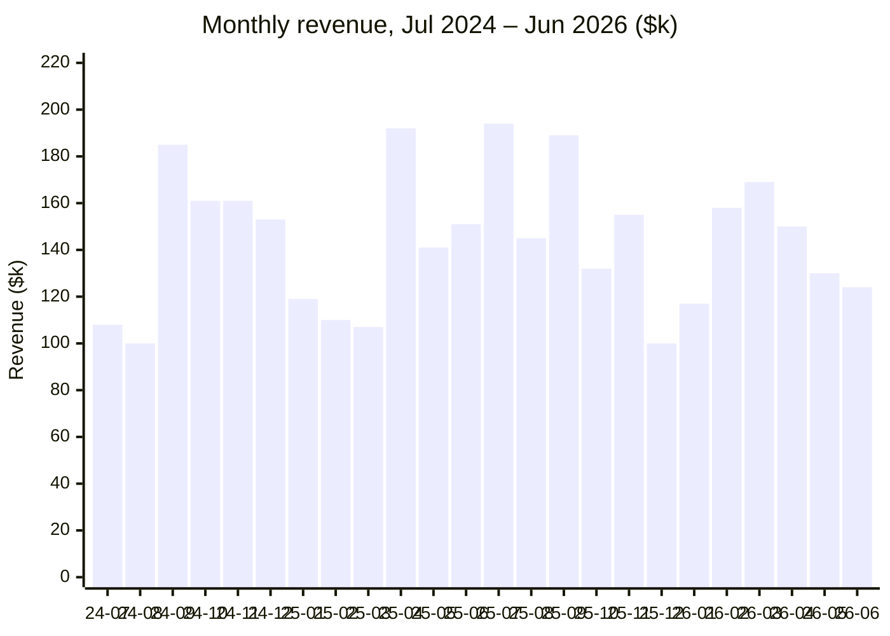
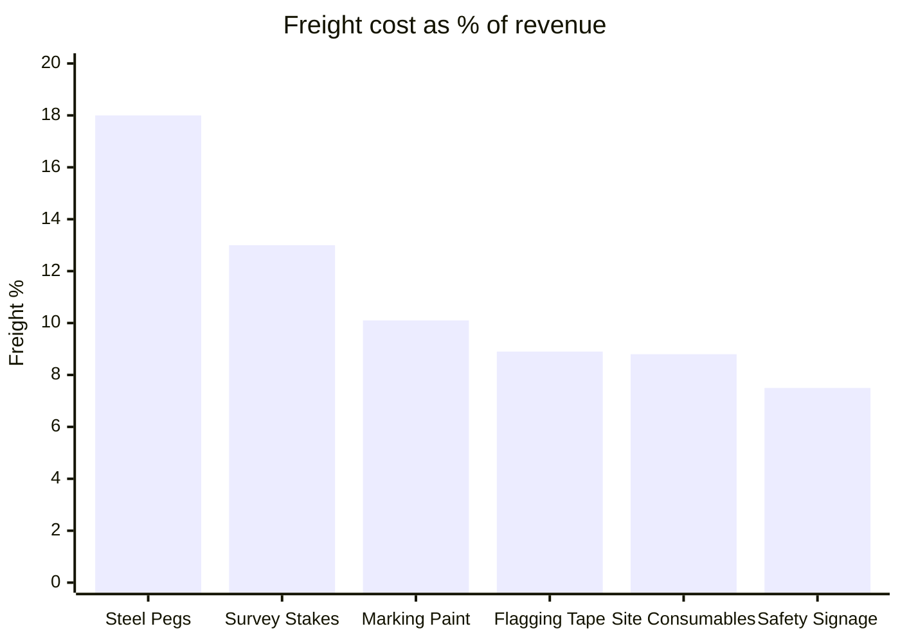

# Industrial Supplies Sales Analysis

**Tools:** Python (pandas) · SQL (SQLite) · Data cleaning · KPI reporting

An end-to-end sales performance analysis for a B2B industrial supplies distributor selling survey stakes, marking paint, signage and site consumables to mining, construction and surveying customers across Australia. It covers two financial years: FY25 (Jul 2024–Jun 2025) and FY26 (Jul 2025–Jun 2026).

> **Data note:** the dataset is **simulated**. `src/generate_data.py` builds 2,877 orders for 60 customers from fixed rules and a random seed, so anyone can recreate the exact same file. No real company or customer data is used.

## Business questions
1. How is revenue trending, and how did FY26 compare with FY25?
2. Which product categories drive revenue, and which carry the most freight cost?
3. How dependent is the business on its largest customers?
4. Which regions are most expensive to serve?
5. Which customer sectors are growing fastest?

## Key findings

| Metric | FY25 | FY26 | Change |
|---|---:|---:|---:|
| Revenue | $1,687,555 | $1,762,831 | **+4.5%** |
| Orders | 1,347 | 1,530 | +13.6% |
| Average order value | $1,253 | $1,152 | **−8.0%** |
| Freight as % of revenue | 9.4% | 9.3% | −0.1 pts |

- **Growth came from more orders, not bigger ones.** Orders rose 13.6% but average order value fell 8%. Smaller orders cost relatively more to pick and ship, so order minimums or bundle pricing are worth testing.
- **Very high customer concentration.** The largest customer is **55.6%** of two-year revenue; the top 5 are **74.8%** and just **8 of 60 customers** make up 80%. Losing one account would be a major risk, so account management and new-customer growth matter.
- **Safety Signage leads revenue** at 46% of sales with the lowest freight burden (7.5%). **Steel Pegs** carry the highest freight cost at **18%** of revenue because they are heavy and low in value, a candidate for a freight surcharge or minimum order.
- **Remote regions cost more to serve.** Freight is **14.6%** of revenue in NT and 11.2% in NSW, against **6.4%** in WA, the home market.
- **Surveying is the fastest-growing sector** (+79% year on year, from a small base), while construction fell 4.5%.

### Monthly revenue (AUD thousands)



Revenue dips every December–January with the Christmas site shutdown, and swings month to month with the timing of large customers' orders.

### Freight cost as % of revenue by category



## Recommendations
1. **Reduce customer concentration:** set a target to win new mid-size mining and surveying accounts, and track the top customer's share every quarter.
2. **Protect margin on small orders:** test a minimum order value or a small-order freight charge, starting with Steel Pegs and Survey Stakes.
3. **Review interstate freight:** negotiate consolidated freight rates for NT and NSW, or price freight into interstate quotes.
4. **Back the growth sector:** surveying customers grew fastest, so focus marketing on survey stakes, flagging tape and marking paint bundles.

## Project structure

```
industrial-sales-analysis/
├── src/
│   ├── generate_data.py      # builds the simulated dataset (data/orders.csv)
│   └── analysis.py           # pandas analysis, writes summary CSVs to outputs/
├── sql/
│   └── analysis_queries.sql  # the same analysis in SQL (CTEs and window functions)
├── requirements.txt
└── README.md
```

## How to run

```bash
pip install -r requirements.txt
python src/generate_data.py   # creates data/orders.csv
python src/analysis.py        # prints results and writes outputs/*.csv
```

To run the SQL version, load `data/orders.csv` into SQLite as a table called `orders` and run `sql/analysis_queries.sql`. The SQL and Python results match.

## Skills shown
- Building a reproducible dataset and analysis pipeline in Python
- Aggregation, pivoting and KPI calculation with pandas
- SQL with CTEs and window functions (`SUM() OVER`, `LAG()`)
- Australian financial year reporting
- Turning analysis into clear business findings and recommendations

---
*Author: [Ashish Bhuva](https://github.com/ashishbhuva) · Data Analyst · Perth, WA*
